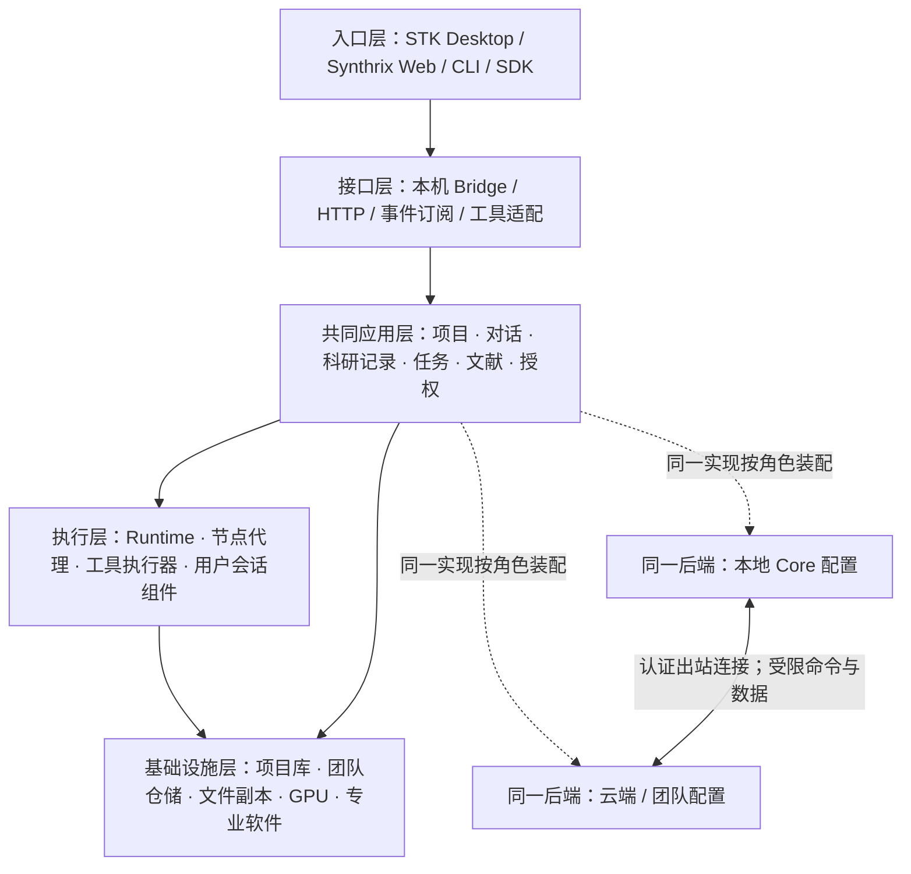

# 分布式科研平台总体框架

2026-11-06。用于启动会与后续跨团队协作；这是目标框架，不是当前功能清单。
实施语义以[共同后端设计](shared-backend-architecture.md)、[任务与数据协议](distributed-task-data-protocol.md)和已发布 `docs/specs/` 为准。
排期见[滚动开发计划](../planning/platform-roadmap.md)，仓库边界见[多仓库规划](../planning/repository-strategy.md)，汇报见[启动会提纲](../planning/research-kickoff.md)。

## 产品目标与使用方式

建立以 STK 为主体的科研工作台，把已有计算前后处理、原生三维交互和本地文献能力，与 Synthrix 对话和科研管理结合。
同一账号在获授权的网页、桌面和 CLI 中找到同一项目、任务及结果；计算留在具备数据、硬件和软件许可的节点。
本地工作不以官方云在线为前提；云端负责获准的协作与协调，也可在独立配额和隔离条件满足后提供托管计算。

| 入口 | 重点体验 | 执行位置 |
|---|---|---|
| STK Desktop | 三维操作、原生 PDF 阅读/标注、数据整理、科学脚本和完整工作台 | 本机或获授权的其他节点；保留 C++ / Python / GPU |
| Synthrix Web | AI 对话、研究记录、轻量分析、文档阅读、任务追踪 | 共同后端及已连接节点；React 页面不另建业务状态机 |
| CLI / SDK | 自动化提交、状态/日志、结果获取、工作流集成 | 指定节点或符合约束的节点；终端退出不取消已接受任务 |

共同信息架构为项目、对话、文件/文献、任务/结果、能力目录。商城先作为后续分发入口，交易不进入首期试点。

## 五层框架与两个部署位置

| 层 | 统一内容 | 可以不同的部分 |
|---|---|---|
| 入口 | 稳定对象引用、显式操作和错误语义 | C++ 原生 UI 与 React Web；相机、布局等界面状态 |
| 接口 | 共同应用服务、请求校验和版本合同 | 本地 IPC、网络 HTTP 和事件传输适配 |
| 应用 | 领域模型、权限、幂等、事务、修订、任务生命周期 | 部署启用的模块和限额；不能复制云端业务分支 |
| 执行 | 接受/启动/退出证据、资源准入、恢复和取消 | 操作系统、硬件、求解器、许可、图形会话 |
| 基础设施 | 仓储/文件接口的语义和一致性要求 | SQLite 项目库、PostgreSQL 团队仓储及具体存储；逐适配验证 |

本机 Core、云端服务和节点角色来自同一后端源码及版本清单，可以分进程部署。
共同后端以当前 `suan/` 服务为基础；Synthrix 旧 Node/Fastify 业务按领域迁移，兼容层有退出条件。
图形界面不属于后台启动依赖；C++ 计算与 GPU 能力按实际平台提供，Python 科学依赖按执行器安装。

## 四条贯穿全系统的规则

1. **事实归属明确。** 项目有写入归属和修订；任务有唯一调度归属；Hub action、Runtime task、项目 run 各保留身份。多个入口不能产生多份可写事实。
2. **任务可追踪。** 先冻结请求/输入，再明确运行；断线、取消意图和实际停止分别记录。失联不自动重算，旧回执缺失不猜补。
3. **数据按位置与权限使用。** 原件/索引默认留节点，预览和原始数据分别授权。账户绑定不等于上传整库、控制桌面或向外部模型发送私有内容。
4. **科研结论有独立证据。** 工程执行成功、文件完整、科学合理、专家复核分别判断；真实许可、GPU、参考曲线与跨平台运行不能由模拟代替。

本地已授权的独立任务可离线工作；依赖远端续租的任务遵守冻结的有限离线授权窗口。
Computer Use 由用户会话内组件执行，单独授权，后台节点在线不代表桌面可控。
既有模型端点、密钥和网络策略的桌面限定保持；S2c Agent 权限等旧待决不因架构设计而获准。

## 首期试点展示什么

候选主链：网页明确提交 → Linux 节点执行公开合成算例 → 另一终端按原 ID 追踪 → 校验结果 → 网页轻预览 / Desktop 完整查看。
先证明同一后端双部署、任务身份和数据来源，再按真实资产就绪情况接一项专业软件/GPU 场景。
选择一项 Synthrix 科研记录或对话关联的领域切片，验证其复用共同后端；不把全部科研业务迁移写成首期承诺。

| 已有基础（来自源码/既有记录） | 新目标，尚待实现或本轮实测 |
|---|---|
| 原生 C++ 编辑器和 GPU 可视化基础；Python 项目/桥/科学服务 | Core 无 GUI 统一装配，以及本地/云端同实现一致性 |
| Linux Runtime、Hub、出站节点代理和 CLI 查询能力 | 当前 React 网页的完整接入、账号/节点统一及三端真实操作 |
| Synthrix React 页面及独立 Node/Fastify 领域服务 | 领域逐项迁入共同后端，原身份/回执/修订的兼容恢复 |
| 已交付架构、任务数据及验收设计 | 原生 PDF 标注、真实许可/GPU、多平台完整节点和发行矩阵 |

这里的“已有”不表示本轮重新测试或部署成功。当前本地代码基线 535b0d63、设计基线 f541393b；
完整产品与跨平台节点不能依据设计文档宣称已完成。

## 仓库与版本不是同一个边界

共同后端必须只有一个实现来源，但前端与跨仓集成可以独立仓库发布。
建议当前 STK 仓保留 Core、Desktop、CLI 和发布协议；Synthrix 仓承载 React 与受控迁移兼容层；
按需要新增或复用一个集成发布仓（候选名 `stk-platform`），保存经验证的精确版本组合和跨仓验收。新增仓库仅为提案，本轮不创建仓库。
后端/桌面暂留同仓，减少原生桥、数据格式和 Python 服务共同修改的协调成本；满足独立维护/发布条件再评估拆分。

每个阶段交付功能演示、来源版本和剩余限制。每周例会只采用这些证据判断进展，
以[开发计划的退出条件](../planning/platform-roadmap.md)推进，不将“代码提交”“接口 mock 通过”或“文档写完”直接称为用户功能完成。

## 本轮工作边界

本材料延续所有者已批准的设计工作与直接证据方式；AOCI 完整加载/维护继续暂缓，既有资产保持。
公开材料使用“合作方”，不包含内部访问地址、身份凭据、真实受限数据或未授权许可资产。
本文不改发布契约、不建立新仓、不迁移数据、不触发部署，也不替代已有八项研发范围和三项待决。
