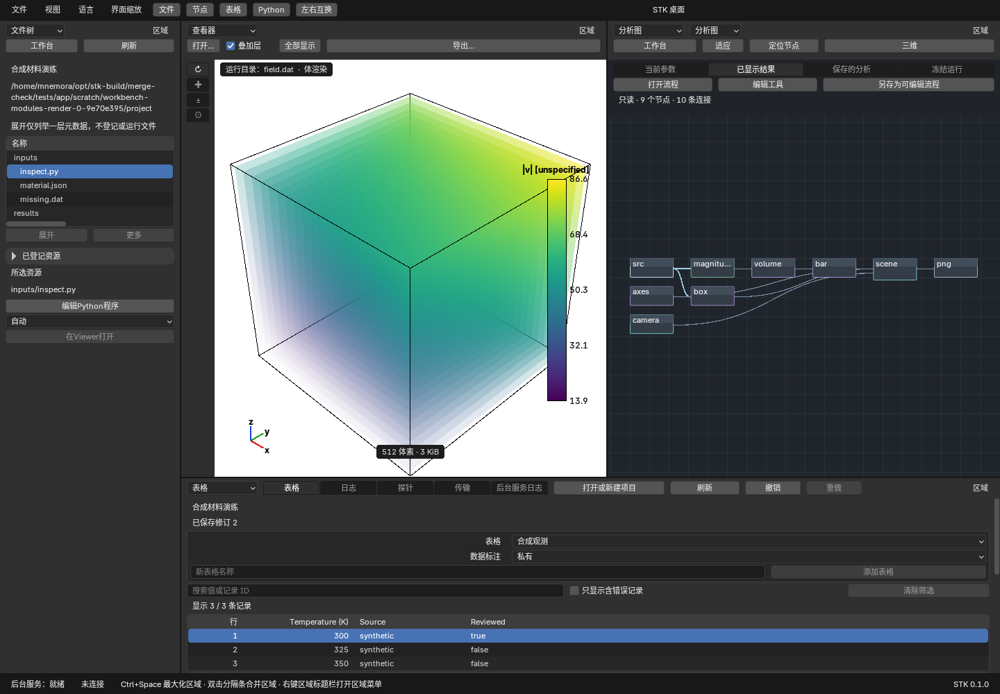
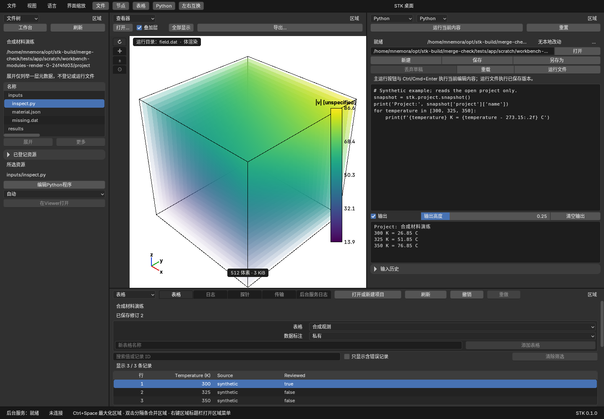
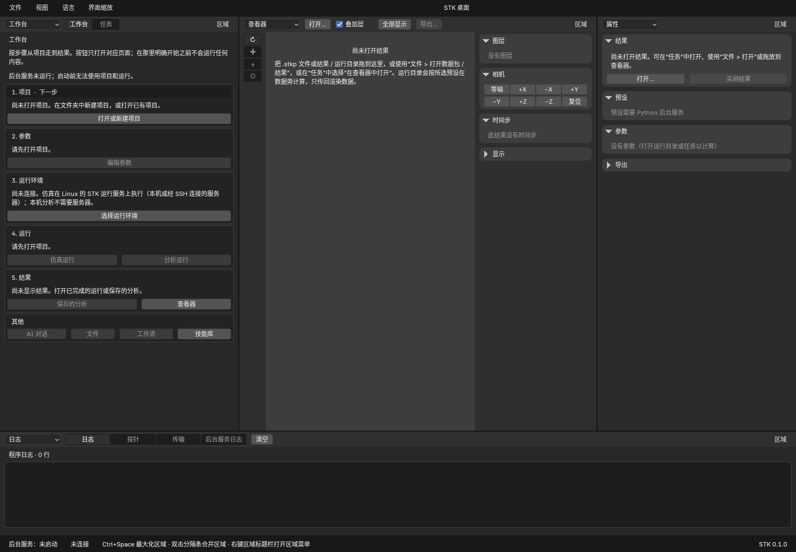
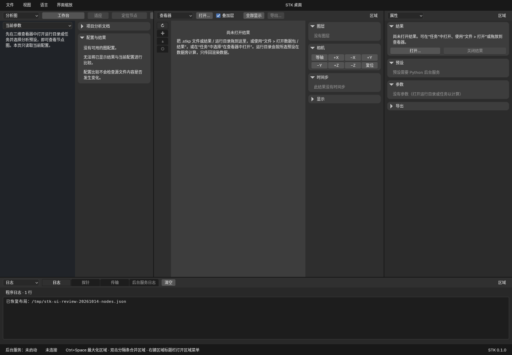
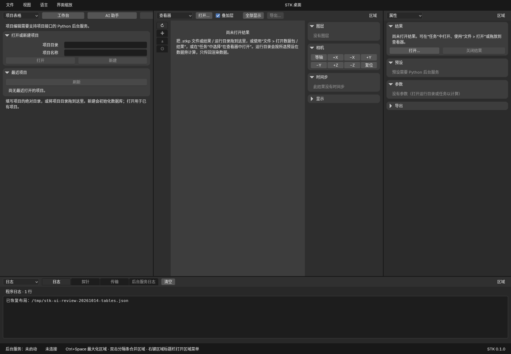
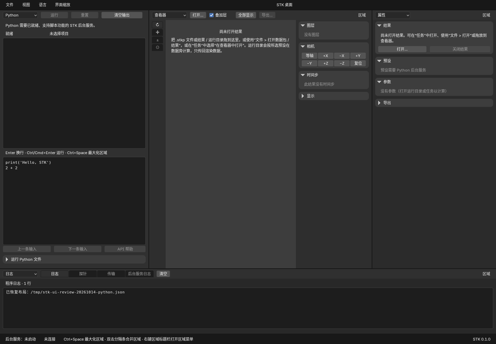

# 项目工作台设计

更新：2026-10-15。模块化与常驻可视化已交付；本地多维表格扩展及实际验收见
[多维表格](multidimensional-tables.md)和[验收记录](../runtime-validation.md)。
开发次序见[开发计划](../development-plan.md)，持久化与计算规则见[项目数据模型](project-model.md)。
本文区分目标行为与已实现首版；当前使用说明见[桌面指南](../desktop.md#ai-助手)。

## 2026-10-14：所有者补充的界面要求

所有者实际查看桌面后明确提出以下工作方式。这是已确认的产品方向；下面分别记录本轮实现、历史基线和剩余目标。

- 主工作区持续保留可视化，旁边同时使用数据处理节点图或 Python 程序编辑器。两者可在左或右，不因进入其他编辑页面而隐藏 Viewer。
- 节点流水线应直接可发现、可编辑，区分整体项目工作流和后处理/渲染的数据分析图。
- 表格是独立窗口类型，服务输入、参数、数据检查和输出展示。单元格可引用文件、结构、分析结果等对象，不能只显示文字。
- 文件树是独立窗口类型，提供目录层级浏览；文件登记表与文件树可以联动，但不能互相冒充。
- Python 页面以程序编辑为主，上方有明确的运行操作，执行输出在下方；保留已有脚本会话、项目 API 和中断能力。

### 本轮模块化实现与少点击指标

原生编辑器拆为 11 个可单独构建的模块，共用项目/修订/撤销、Viewer、执行与后台服务。
默认布局直接显示真实文件树、Viewer、分析节点与独立表格，旁边的编辑区可一键切换 Python；
顶部同时给出文件、节点、表格、Python 与左右交换入口。窄栏采用两行页头，所有标签也可从区域菜单访问。
普通导航维持分栏；旧布局中藏在 Viewer 后面的程序页会移动原实例，保留草稿、相机与来源。
原自定义布局仍保留；要使用新默认布局，可在“视图”菜单选择“恢复默认布局”（先保存或放弃需要销毁的编辑草稿）。

“减少用户点击次数”是核心交付指标，固定起点、真实鼠标事件和任务终态，不用隐藏确认或自动运行降低数字。
新默认四个主要区域是 **0 次导航点击**；Python、切回节点、左右交换各 **1 次**。
同一旧单 Viewer 起点，传统文件菜单进入 Python **2 次**，顶部入口 **1 次**；分别检验布局与执行状态。
中英文、900 像素逻辑宽度、1/1.5/2 倍缩放也验证一次点击；实际测试、CI 与限制见[验收](../runtime-validation.md)。

表格复用现有五种字段、引用、公式和撤销，点击单元格可选定字段并查看有界 JSON 详情。
文件树按需列举一层元数据，登记状态单独显示；打开 `.py` 复用旁边代码区，读取本身不执行。
Python 代码在上、可收起的输出在下，支持载入、新建、保存、另存、冲突保护、显式运行与中断。
分析图主体提供打开流程、从模板新建及另存可编辑流程；只读来源和新草稿继续区分。

截图使用公开合成数据和真实本机后台，没有模型/Runtime 请求。它不等于 PET 收敛物性、读屏或跨平台真机人工验收。
模块边界、构建入口和指标维护见[桌面模块](../desktop-modules.md)。二进制热插拔、完整 IDE、批量粘贴、
结构/文件/分析结果的专用富对象单元格及缩略图仍未实现；不会把 JSON 文本当作完整富对象契约。

### 改版前的核对与差距

核对基线为 `6a6218d` 的源码及本机已有原生二进制；四个冷启动界面已在本次重新捕获并目检，截图不是改版效果图。
截图未连接 Python 后台服务、未打开项目；只能证明空状态布局，不能据此声称节点、表格或脚本的完整交互已验收。
已建二进制的文案可能先于当前源码字典，快捷键行为以源码和实际交互测试为准。

| 顺序与截图 | 实际情况 | 对这次改版的影响 |
|---|---|---|
| 1. [默认工作台](../images/desktop/ui-review-20261014-default.png) | 工作台/任务、Viewer、属性、日志四区域；节点、表格、Python 不在默认标签中 | 应直接呈现常用工作方式，收起占据大面积的空属性/日志区 |
| 2. [分析图入口](../images/desktop/ui-review-20261014-nodes.png) | 已有独立分析图与项目工作流；保存分析支持增删节点、拖线、参数与输出编辑；当前预设/历史图主要只读 | 入口、来源和可编辑状态必须明确；不能把只读状态显示成缺少节点功能 |
| 3. [项目表格入口](../images/desktop/ui-review-20261014-tables.png) | 已有类型化表格、UUID、引用、公式、单位、排序和筛选；主页面还混有仿真、快照、文件等操作 | 应提取独立表格工作区；JSON 摘要不是已实现的富对象单元格 |
| 4. [Python 页面](../images/desktop/ui-review-20261014-python.png) | 已有运行/中断按钮，输出在前、输入仅约占 35% 高度；文件入口主要运行现有文件 | 改为代码主区域、输出次区域，并补齐载入、编辑与保存程序文件 |

1. 默认工作台：常用编辑器尚未直接呈现。

2. 分析图：未加载项目/配置时的空状态；已实现编辑能力另以源码核对。

3. 项目表格：当前入口先显示项目打开/创建，没有独立对象表格工作区。

4. Python：输出在前，代码输入在后；页头已有运行操作。

源码核查还发现导航会遮住 Viewer：首次从文件菜单打开 Python 等编辑器时，目的区域优先取当前 Viewer 区域；
若干分析/工作流导航默认最大化。应统一修正目的区域选择，普通导航维持并排，只有明确“聚焦”操作才最大化。
盘点时缺少保留区域实例的左右交换接口；本轮已增加真实区域交换，不通过布局重载模拟。

### 布局与编辑规则

建议起始布局为：窄文件树放侧边，Viewer 与工作编辑区并排，工作编辑区可切换数据分析图、项目流程、Python；
表格可单独分栏或放在下方，日志/执行输出按需展开。具体左右和比例可调整，所有者没有要求固定某一侧。
切换节点、代码、表格和文件树不能替换已打开的可视化数据，也不能自动执行程序或重新提交模拟。
布局调整和恢复须保留未保存的代码/节点/单元格草稿、Viewer 相机与实际时间步；旧布局继续可打开。

数据分析图需直接给出“新建 / 从当前配置另存为可编辑流程 / 打开流程”的入口。
编辑定义、执行数据处理、更新 Viewer 是可辨别的动作；当前 Viewer 结果与新草稿不同，应显示来源与状态。
项目整体工作流与数据分析图共享对象身份和导航上下文，保留已有冻结运行的只读语义。

表格字段逐步增加有类型的对象引用、摘要/缩略图和详情动作，并复用参数与节点的类型声明。
文件、原子结构和结果引用应绑定稳定对象及版本，不用字符串路径、任意 Python 对象或 JSON 文本冒充完整类型契约。
大型数组和轨迹仍作为文件/归档资源，单元格呈现摘要与引用；科学结果保留原始类型、单位、来源与只读状态。
当前五种字段类型和既有引用/公式继续有效；新增对象类型及渲染/编辑扩展须有兼容契约。

文件树需要区分磁盘真实目录与项目已登记资源，并明确缺失、外部和未登记状态。
现有文件索引只接收文件、不做递归扫描；实际目录列举需要有界、按需加载的服务接口，不能在 UI 每帧同步遍历。
打开程序文件进入代码编辑器，打开科学结果进入对应预览；选中、展开或刷新目录本身不运行代码。

Python 以可编辑程序文本为主体，提供运行、中断、载入/保存和清楚的执行状态，输出区可调整或收起。
复用现有脚本 worker 与 `stk` API；运行当前草稿和运行已保存文件的来源应明确。VSCode 保留为可选外部编辑器，
不再以“编程只交给 VSCode”替代应用内的基础程序编辑体验，也不由此要求内置调试器或完整 IDE。

### 实施次序与验收

1. 先统一导航与默认工作布局，给节点/表格/文件树/Python 明确的窗口入口，保留常驻 Viewer。
2. 提取独立表格、增加文件树、将 Python 改为代码主页面；复用现有数据与执行接口。
3. 扩展对象单元格、节点/表格/文件联动与类型契约，不能把基础页面拆分当作完整多维表格交付。

验收须覆盖：已打开 PET 轨迹时进入四类编辑器仍可旋转/切步；左右交换及重开布局保留草稿和视图；
输入、输出和对象单元格的身份/单位/来源正确；目录展开、节点编辑和项目重开不自动计算；
程序载入、编辑、保存、明确运行、中断及错误输出形成闭环。中英文、宽窄布局、键盘焦点与高 DPI 分别复核。
截图可见的拥挤页头和不明显入口作为可访问性风险处理，不能据截图声称键盘、读屏或 WCAG 验收通过。

## 五类内容与项目工作台

2026-10-05 讨论确认以项目、文件、技能、工作流、对话组织工作台；运行记录保留独立身份，作为工作流的历史浏览。

| 内容 | 职责与关联 |
|---|---|
| 项目 | 组织研究目标、对象引用和修改历史；提供当前工作范围 |
| 文件 | 输入、代码、科学数据、图像与报告的实体资源；可追踪所属节点和运行 |
| 技能 | 可复用的方法说明、参数与输入/输出契约、执行入口、版本、依赖和示例 |
| 工作流 | 带具体参数、输入绑定与依赖关系的技能/操作组合；复杂步骤未来可封装为子流程 |
| 对话 | 讨论目标、提出可检查的操作方案、解释结果；引用项目对象的明确版本 |
| 运行记录 | 某次工作流执行的冻结配置、状态、日志与产物；重算产生新的运行身份 |

目标导航分为全局入口（新对话、项目列表、共享技能库）与项目内部（对话、文件、工作流、运行历史）。
中央工作区随对象显示对话、图、表格、3D 或文档，详情区呈现参数、来源和关联。
可先开始对话并选择文件、形成研究任务后归入项目，是后续交互目标，现有 AI 助手仍要求打开项目。
技能说明与可执行接口分开；方法说明本身不能绕过共享操作接口的类型、版本或执行校验。

本轮首版复用已有原生编辑器，增加 **文件 → 工作台** 和项目/AI/分析图页头的返回入口。
工作台显示当前项目，导航到对话、文件、保存的分析流程、分析运行、仿真运行、项目表格和项目管理；
导航复用编辑器，明确定位子页面，不覆盖未保存草稿、冻结运行或 Viewer。
2026-10-14 前文件入口选中文件索引表；本轮改为独立真实目录树，保留共享表格选择。表格本身仍共享项目选择。
切表前检查所有窗口及隐藏标签的项目单元格及表/字段名称草稿；有未应用编辑时保持选择和布局，提示先应用或重新载入。
进入运行页后由用户刷新列表；导航不准备、发送或执行。项目切换后的旧入口失效，任一窗口的活动文本输入阻止项目路由。
2026-10-06 曾以分步工作台开始；2026-10-14 默认改为本文开头的组合编辑区，引导工作台仍保留；
全局侧栏、全局用户技能目录、对象附件与 UUID 深链接尚未交付。
全局“技能库”已有只读首版：工作台和文件菜单无需项目即可打开版本化技能目录，见[技能目录](../skills.md)；
它只浏览契约，不运行技能；项目版本固定、升级、恢复与创建保存分析已交付。从保存分析发布项目内用户技能正在验收，
技能对话附件与项目工作流整体封装仍待实现。

## 工作模式与共享上下文

工作台围绕一个科研项目组织模拟、分析与成果，而非把任务、查看器和聊天做成互不关联的应用。

| 工作模式 | 主要内容 | 同时可访问 |
|---|---|---|
| 准备与运行 | AI 对话、可编辑的计划和批次参数表 | 项目流程、输入文件、程序入口、任务状态与日志 |
| 结果分析 | 3D、二维图、数据表及分析子图 | AI、参数、运行历史、来源文件与探针 |
| 文档与报告 | Markdown、HTML、PDF 和关联图像/视频 | AI、数据来源、LaTeX 编译日志与 VSCode 入口 |

目标是准备阶段默认以 AI 助手为中心；进入后处理后以结果视图为中心。模式切换共享项目、当前批次、
选中对象与运行版本，不要求重新选择数据。AI 在其他模式仍可使用。
2026-10-14 所有者已明确 Viewer 与节点/代码并排、表格和文件树独立成窗；具体比例与多窗口细节继续以交互验证完善，见本文开头。

现阶段先提供当前窗口的 **聚焦准备 / 聚焦分析 / 恢复分栏布局** 导航，以及对应 Python 激活编辑器接口。
它复用已有 AI/Viewer 对象并最大化区域，保留分割树、其他标签及未保存输入；恢复分栏保留当前标签选择。
2026-10-25 增加当前窗口的 **准备与运行布局 / 结果分析布局**：各自记忆分栏位置与比例、最大化区域、
活动标签和工具栏／侧栏偏好，并随普通布局及完整工作空间保存。初次准备布局显示 AI 并给它较大比例；
返回分析布局恢复离开前的视图。切换移动原区域对象，不重新创建编辑器，不发送、运行或保存项目内容。
2026-10-26 增加 **文档与报告布局**，在同一工作区打开或复用报告页，保持 Viewer、文件与表格可访问。
区域与标签的增删在三模式间共享；区域集合变化后保留当前分栏，再恢复仍存在标签的偏好，
不复活已关闭区域或丢弃新草稿。旧两模式文件继续读取；默认启动模式保持结果分析。
报告模式每次切换仍为 2 次点击，不发送问题或创建报告；完整 AI 生成表单及 LaTeX、视频继续按 P4 推进。

AI 的首要任务是帮助准备和运行一组模拟，随后支持已有数据分析。聊天产生的是项目中的结构化内容：
参数表、流程、执行计划、运行记录和报告。用户可检查、修改和复用这些内容；离开对话后仍能继续工作。
手动操作和 AI 使用同一套校验、修改与执行接口，避免 AI 隐式维护另一份参数或工作流。
明确的批次执行请求可驱动已确定计划执行；单纯编辑参数、让 AI 解释结果不会启动新计算。

当前界面内的 Python 程序页支持编辑/保存/运行与配置工作区布局，后续逐步覆盖全部公开操作；
Python、AI 与手动界面共用命令和上下文。远程连接支持直接连接与 SSH，具体状态与实施方案见
[Python 自动化、布局编程与机器间通信](scripting-and-connections.md)。Python 控制台、项目/布局/Runtime/Viewer
基础 API 及 Runtime SSH 管理已交付；全部操作覆盖与跨平台通用对等通信仍待开发。

近期先用真实 MuFerro 案例贯通输入准备、参数编辑、明确运行、结果收集和三维检查，再扩展批次与 AI。
这是实现顺序，不改变准备阶段以 AI 为主要入口的产品目标；具体验收见[开发计划](../development-plan.md)。

### 当前 AI 助手首版

独立原生编辑器从项目页头/文件菜单进入，保持原默认布局。宽窗口并排显示数据与对话，窄窗口折叠数据设置。
下一条问题使用明确捕获的数据：可快速捕获选中记录全部字段，或在同页勾选多行和部分字段。
选择器固定打开时的表格与修订，不跟随实时编辑或表格筛选；范围改变后仍须明确捕获，成功前不能准备新问题。
保存上下文与已保存问答的来源分别标示，不用当前实时值替换历史数据。
用户先准备问题及请求意图，再核对保存内容并明确发送。原生页面可导航已保存问答，按宽度换行显示普通文字；
未准备的问题和模型选择仅在每个编辑器内按项目保留，不写入项目或布局文件。
准备分两次持久操作：消息保存后，请求创建失败可留下原消息；界面只发布来源完整的问答。
对当前相同输入的身份复用限于同次会话，不表示跨重启原子事务恢复。

工作区显示时，运行中/不确定请求约每秒读取一次本地状态，最多 90 秒；错误/到期暂停，明确刷新可恢复。
可用时同时读取本桥内存中的流式片段，临时显示并明确标记；只有完整校验后的回复才保存。
这不会查询提供方状态，也不会自动发送、恢复执行或应用修改。单条请求不隐式携带其他问答和文件。
参数建议通过版本化结构化文字回复生成，明确转换后保存草案及来源，再明确打开检查、预览和应用；
仅允许捕获范围内的普通标量编辑，不替换公式/引用，不运行代码或提交任务。
沿用格式 8，流式和参数建议各自已有本机与跨平台回归，具体范围见[验收记录](../runtime-validation.md)。
macOS/Windows 原生真实模型使用仍单独验收。自动化模拟流程、通用工具提案及默认 AI 主工作模式继续按计划推进。

## 多层节点编辑器

现阶段先接入[原生分析节点图检查](../analysis-graphs.md)：读取 Viewer 的平面分析预设，以节点画布和通用参数表
显示端口、引用与输出。当前参数和已显示结果的提交配置分开，结果哈希核对通过后才对应执行回执；显式校验不运行节点。
项目内[分析定义保存](../project-analyses.md)已复用普通表格、固定 UUID、修订检查和撤销：一条记录保存完整图、
提交参数和输出选择，原生与 Python 共用接口。读取文档使用独立来源，不关联当前 Viewer 回执或自动求值。
原生参数与有序输出选择已共用保留精确 JSON 类型的本地草稿，明确保存以预期修订检查后原子提交，
一次撤销恢复两者；未设置、显式 `null` 和空输出 `[]` 保持区别，图和名称不随该编辑改变。
格式 9 的[分析执行记录](../project-analysis-runs.md)进一步把完整定义与不可变输入快照、显式文件映射绑定，
准备、执行、读取归档和导入空 Viewer 保持独立。原定义或原文件的后续编辑不改写旧运行；中断执行不自动重放。
历史运行可明确打开独立的只读冻结图，不跟随当前保存定义或运行列表选择，也不替换未保存草稿。
节点尚未拆成独立项目记录；保存分析的图已可编辑（增删节点、单/多输入连线、节点参数、公开输出、画布拖动与拖线，
见[编辑连线与图结构](../project-analyses.md#编辑连线与图结构)）。项目工作流、进入分析/返回与按行执行已交付，
见[项目工作流指南](../project-workflows.md)和[已确认的设计](project-workflows.md)。任意层级的通用子图与跨运行结果比较仍按下述目标推进。

项目层表达整体过程，例如“输入准备 → 参数扫描 → 模拟运行 → 结果分析 → 报告”。
进入“结果分析”节点后编辑数据处理子图，例如“读取 → 筛选 → 派生量 → 统计 → 可视化”。
其他复杂步骤也可成为子图；每层具有明确的输入、输出和可暴露参数，支持面包屑返回上层。

项目层不必把所有过程画成单链；可有分支、汇合和任务依赖。第一版的求值依赖要求无环，
不把迭代求解器内部循环直接解释为可递归触发的图循环。

批次表中一行表示一个模拟实例；所有行复用流程定义并绑定各自参数，避免复制成百上千份节点图。
模板修改后要显示影响范围，不能改写已完成运行的流程快照。

不同连线具有不同语义，不以“数据库里有关联”替代类型检查和执行规则：

| 关系 | 示例 | 行为 |
|---|---|---|
| 对象关联 | 图片属于某次运行 | 导航、筛选与来源追踪，本身不触发计算 |
| 参数依赖 | 输入 B 引用参数 A | 类型/单位校验、求值与失效传播 |
| 数据流 | 数据集输出接到等值面输入 | 按端口契约校验并传递数据 |
| 执行依赖 | 分析等待模拟完成 | 调度与失败/取消传播，复用现有执行服务 |

图、参数表与结果视图显示同一对象。图选中节点可检查其参数表；表格中的节点引用可定位到图。
现有项目工作流与分析两层映射已按[项目工作流方案](project-workflows.md)实施；通用嵌套子图和模板迁移仍未实现。

## 通用多维表格

表格是输入编辑、数据检查和对象管理的共同界面，不仅是分析结果的只读附件。
逻辑表可由项目模型的查询/关联形成，不要求每个可见表格都对应一张物理 SQL 表。

当前已交付的结果检查是[不可变归档的类型化属性和内联科学表格视图](../project-analysis-runs.md#以科学表格查看内联结果)：
按原始列序和源行序分页，明确跳转后可检查完整名称、单位、实际 JSON 类型及精确值，不自动运行或读取额外文件。
源坐标只在固定的冻结运行、已校验结果和输出内标识单元格，不能冒充全局可编辑项目 UUID，
也不能在切换运行后自动指向另一个表格。视图不把每个结果值写成 SQLite 单元格；
目前没有结果编辑、排序/筛选或 blob 表格读取。这一实现是通用表格方向的一部分，尚非完整多维表格或插件框架。

两种基本形态共用字段定义与编辑器：

- **参数/属性表**：一行一个参数，显示名称、值或表达式、单位、来源、校验状态和计算结果。
- **记录表**：一行一个运行、文件、节点或其他对象，支持排序、过滤、关联、选中与批量编辑。

字段类型包括数值、单位、向量、枚举、文本、富文本、图像、链接、文件附件及节点/数据引用。
编辑权限、必填、默认值、校验、预览和动作由类型与对象元数据共同决定；计算结果等只读值有清晰标记。
用户能在原始字面量、引用/表达式和计算结果之间切换查看，并定位错误依赖。

插件和节点类型提供字段声明、渲染/编辑扩展、预览与动作；通用表格、节点参数面板、AI 工具
消费同一份语义元数据。扩展基于现有节点目录和类型定义演进，注册协议与兼容版本仍需设计。
“通用”指支持注册的类型和插件，不意味着单元格可执行任意插件代码。

内置科学功能计划从 `toolkits/` 按职责整合进 `suan/`；能否作为插件使用由注册契约决定，
与源码是否位于 `toolkits/` 无关。外部扩展与内置功能使用共同接口；现有 `plugins/` 主要是可选平台集成，
通用节点/字段/预览插件机制仍待开发。迁移方向见[仓库结构说明](../repository-structure.md)。

单元格使用摘要、缩略图或链接，详细富文本、PDF、交互图和 3D 在详情/预览区打开。
大型科学数组保留原有数据格式，通过摘要、分页或选定区域查看，不默认逐体素存成数据库单元格。
批量编辑应显示校验与受影响范围；排序或过滤不会改变引用的对象身份。

## 文件、代码与科研文档

文件资源表统一管理输入、输出、处理结果、图像、视频、Markdown、程序和报告。
记录路径/位置、类型、用途、关联节点/运行、版本、状态、标签和备注；同时保留目录浏览与系统路径访问。
本地与远程资源都能登记，缺失、未下载、传输中和已校验状态不能混淆。

提供“在 VSCode 中打开”项目、文件夹或文件的入口；编译错误可携带文件和行号。
2026-10-14 起，应用内提供基础程序编辑与明确运行是已确认的方向；VSCode 仍可承接完整 IDE 功能。
当前 Python 已支持程序文件载入、编辑、摘要版本校验保存及明确运行；重开和恢复不执行程序。
报告独立标签与冻结资产的范围见[报告指南](../project-reports.md)，完整文档嵌入继续按阶段推进。
外部编辑的文件变化要进入项目修订和依赖检查，历史运行继续指向当时的输入快照。

统一预览区承载 Markdown、HTML、PDF、图像、视频以及科学结果，逐阶段实现：

- AI 生成 HTML 报告时，保存页面、资产、数据引用与来源版本，支持重新打开与后续导出。
- PDF 可作为项目资源打开；翻页、缩放、文本搜索等能力在渲染方案验证中确认支持范围。
- LaTeX 编译由外部工具链执行，可作为流程节点；显示进度、日志与错误，成功后更新 PDF 预览。
- HTML 预览只按定义的接口读取授权的项目资源，页面不能隐式获得任意文件访问或任务执行能力。

保留当前原生 C++ 三维渲染器。嵌入式文档渲染组件尚未选定，需在 macOS / Windows 验证
嵌入、输入焦点、缩放、资源访问、部署体积与许可证；缺少 LaTeX 或 VSCode 时显示可操作的配置提示。
已核对的窗口接口、候选组件和双平台验证条件见[文档预览技术验证计划](document-preview-spike.md)。
该记录尚未完成原型验证，不表示预览组件已经接入。

## 修改、计算与历史

项目修改已有[只读预览基础](../project-preview.md)：结构化命令在内存副本上产生候选表格和公式结果，
原项目保持不变；后续明确应用同一批稳定命令并检查原修订。AI 草案页面应复用这一能力，
继续区分“修改参数”“准备运行方案”和“提交计算”，不把预览成功当作运行已经发生。
原生“修改检查”已支持确定性草案的表格/字段/记录/单元格差异、完整定义和候选公式错误；
可由单元格编辑器发起或输入 JSON 命令，按原修订显式应用并进入普通撤销历史。
当前候选在会话中共享，编辑输入使旧候选失效，关闭/切换或桥重启清除。
格式 6 已提供[显式保存草案](../project-drafts.md)：保存稳定命令与基础修订，重开后明确载入和重新检查；
过期命令须明确复制为新草案，保留原记录。应用命令与回执原子提交，撤销表格不把草案重置为可再次应用。
保存、载入和清空编辑器均不自动应用或提交任务。格式 7 已提供明确选择范围的上下文、文字消息和草案来源关联，
原生“讨论”页可捕获、查看并关联这些记录，见[使用指南](../project-contexts.md)和[设计边界](review-drafts-and-conversations.md)。
格式 8 请求记录及阿里 Token Plan 的显式文字生成已实现，AI 助手首版复用上述记录；
模型生成的受限参数编辑提案与临时流式回复已经接入，完整 AI 主工作模式仍待开发。

轻量引用和派生参数自动计算；模拟、昂贵数据处理及外部程序在输入变化后标记“待重新运行”。
界面显示变更来源、受影响项和旧结果版本，允许按范围执行。已有结果继续可看，但明确标注是否过期。
某次运行完成后，即使项目参数已改变，也应保存其真实输入对应的结果，不能把它当作最新配置的结果。
运行记录不可通过编辑当前参数而被覆盖；重试和重算产生可追溯的新尝试记录。

## 参考与取舍

以下参考用于设计思路，不意味着复制产品布局，也不构成 STK 已实现的能力：

| 参考 | 采用的思路 |
|---|---|
| [ANSYS Workbench](https://ansyshelp.ansys.com/public/Views/Secured/corp/v242/en/wb2_help/wb2h_building.html) | 在项目层表达工作流程与数据依赖 |
| [COMSOL Desktop](https://www.comsol.com/support/learning-center/article/Introduction-to-the-desktop-34131) | 对象选择、参数设置与结果视图的上下文联动 |
| [Houdini 网络](https://www.sidefx.com/docs/houdini/network/index.html)、[参数](https://www.sidefx.com/docs/houdini/network/parms.html)、[数据检查](https://www.sidefx.com/docs/houdini/ref/panes/geosheet.html) | 分层节点、参数引用和处理过程中的数据检查 |
| [飞书多维表格](https://www.feishu.cn/content/article/7574713887522639055) | 有类型字段、对象关联及富内容的统一表格体验 |
| [VSCode CLI](https://code.visualstudio.com/docs/configure/command-line) | 从科研工作台进入外部代码编辑器 |

下一轮设计重点是用首个批量模拟场景验证模式切换、表格与图的联动，以及错误/过期状态的可理解性，
再确定具体布局。
