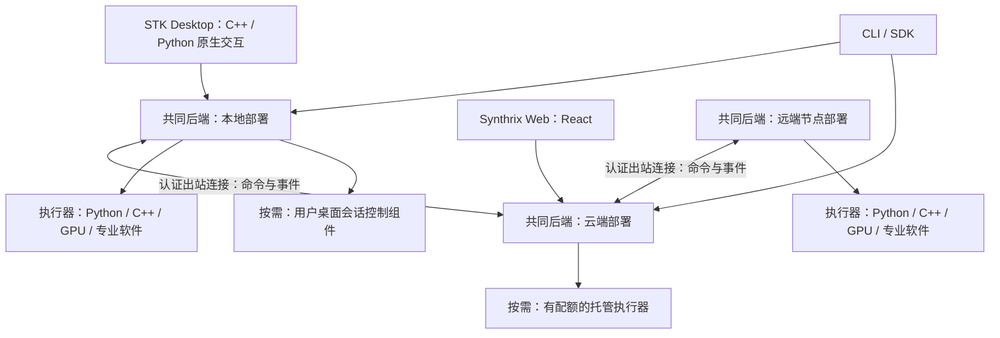

# STK / Synthrix 统一后端架构与迁移边界

更新：2026-11-06 UTC。状态：设计交付，尚未实施；本轮不修改发布协议、数据库格式或产品代码。
所有者已确定：STK 为主体，Core 与云端使用同一后端；STK Desktop 保留 C++ / Python / GPU，Web 使用 React 等网页技术。
下述模块拆分、部署配置与迁移顺序是实现建议，不把这些建议写成已有能力。
配套文档：[任务与数据协议](distributed-task-data-protocol.md)、[完整场景验收](distributed-workbench-acceptance.md)。

## 1. 架构决定与同一后端的含义

本地 Core、自托管服务、官方云端采用**同一套后端源码、领域模型、应用服务、校验、授权与任务状态机**。
部署差异通过明确的角色、能力及基础设施适配器表达，不复制一份云端业务实现。
Desktop、Web、CLI、AI 工具适配器只负责交互、传输和显示；业务写入都进入共同应用服务。

建议以现有 `suan/` Python 服务为共同后端基础，继续复用 C++ 科学/系统组件和独立执行进程；
HTTP 入口优先沿用现有 FastAPI 服务的能力，具体打包与进程装配在实现阶段验证。
Synthrix 的 TypeScript 业务逐项迁入或抽取到这个共同后端，React 保留为网页前端。
迁移期间可存在旧服务的兼容适配器，但必须有明确事实归属和退出条件，不能长期形成两套可写业务主账。

“同一后端”不要求所有模块运行在一个进程，也不要求不同操作系统安装完全相同的二进制。
同一源码修订可生成不同平台的安装包；后端发布清单必须绑定源码、协议、模块和原生依赖版本。
本地与云端对同一业务命令采用同一规则，缺失能力或不同配额应返回明确结果，不能悄悄改变业务语义。

节点连接负责控制消息与获准的数据传输，不要求公开本地 Runtime 或 Desktop Bridge 端口。
直连、大文件传输和中继是独立传输适配；无直连条件时不能默默上传全部原始数据。

## 2. 共享模块与前端边界

| 层 | 同一后端中的职责 | 前端职责与限制 |
|---|---|---|
| 领域模型 | 项目、修订、数据引用、对话、研究记录、任务、节点和权限 | 展示同一稳定身份，不能用当前窗口句柄替代持久 ID |
| 应用服务 | 查询、准备、明确运行、保存、取消、授权、幂等、事务 | 收集输入并展示回执；重开、刷新不隐式发送或执行 |
| 项目与科研服务 | 参数/单位/引用、冻结输入、报告来源、实验与复核 | 计算完成、实测、推断、合成以及科研判断分别呈现 |
| 协调与执行 | 节点目录、任务路由、资源准入、执行器与恢复 | Desktop/Web/CLI 使用相同任务身份与事件，不各建调度器 |
| 存储与传输适配 | 项目仓储、团队仓储、文件副本、事件游标 | 不直接写数据库或根据绝对路径绕过对象授权 |
| AI 与插件适配 | 受控模型调用、工具目录、版本锁定、明确动作 | 对话建议不授予执行权；插件发现不等于安装或运行 |

C++ 原生 Viewer 的相机、缩放、选区、窗口布局等高频界面状态继续由前端管理。
完整三维数组经文件、共享内存或已验证的数据通道交付，不塞进每帧 JSON 请求。
改变项目、保存分析、执行计算、生成文献索引、保存 PDF 标注则走共同业务服务。
Python 可同时用于桌面胶水与后端；模块归属按职责划分，后端不得依赖 GUI 事件循环才能启动。
云端无 GPU 时也能运行账号、项目、对话与任务协调模块，原生渲染和重型科学依赖按需装载。

## 3. 部署配置与能力矩阵

以下配置名为设计概念，尚非 CLI 参数或发布安装包名。

| 配置 | 共同后端启用内容 | 依赖与限制 |
|---|---|---|
| 本地完整 | 本地项目/文献/科研服务、协调、执行、客户端连接 | 无云连接仍可做已具备依赖的本地工作；远程服务和在线模型另受可用性限制 |
| 无头节点 | 节点身份、授权、任务与数据服务、执行器 | 无需 Desktop；只声明真实安装且可使用的能力 |
| 云端/团队协调 | 账号、项目目录、协作、对话、路由、状态投影和配额 | 计算可委托用户节点；托管执行器是可选能力，不是每个任务的必经点 |
| 自托管完整 | 同一后端按部署条件组合上述模块 | 允许团队自行提供资源；仍保持项目授权及数据出站规则 |

首个验证目标是同一后端修订在 Linux 本地和云端两个部署运行，再逐平台补 Windows/macOS 节点。
首期托管配置以协调和获准数据服务为主，用户计算派发到自有授权节点；
现有个人可信 Runtime 不直接作为多租户共享执行沙箱。启用托管计算前，必须通过独立的租户执行隔离、
存储隔离、资源配额与受管执行器验收；部署配置不得仅以放开任意程序提交来提供此能力。
当前 Runtime/Hub/节点代理仍有 Linux 服务限制；桌面或 peer 支持某平台，不证明完整节点已支持该平台。
GPU、专业软件、图形会话、存储和网络能力分别协商，不能仅凭 OS 标签派发任务。
同机本地与远程任务经过相同资源准入；许可席位、GPU 内存和交互会话冲突必须排队或明确拒绝。

## 4. 直接证据与现有模块映射

本轮核验基线：STK 本地源码 `535b0d63d15521ea7d4294ddfce2ac68a3555667`；
Synthrix 当前网页 worktree `a15ab6b006ae348ef862b03773d6380b2e4abb3d`。
下表是源码/契约检查，不代表本轮重新运行已有测试或证明已部署。

| 当前入口 | 直接证据与现有边界 | 目标归属、迁移动作和兼容验证 |
|---|---|---|
| [`suan/project/`](../../suan/project/)、[项目模型](project-model.md) | UI 无关的 ProjectStore；项目修订和远程运行投影分开 | 保留项目领域主体，抽取供两端调用的应用服务；保留 UUID、修订、撤销、冻结快照与显式迁移 |
| [`RuntimeService`](../../suan/runtime/service.py) | 工作区、文件传输、快照、任务操作；执行状态有独立事实来源 | 保留执行服务；增加节点放置/执行尝试时按既有协议版本化，验证旧任务及固定幂等键恢复 |
| [`control/app.py`](../../suan/control/app.py)、[`agent.py`](../../suan/control/agent.py) | FastAPI 控制服务；出站节点代理调用 Runtime，已有任务查询/日志/文件等能力 | 共同后端的协调与节点适配；补账户映射和通用能力合同，保留 action 与 Runtime task 的不同身份 |
| [`desktop_bridge/server.py`](../../suan/desktop_bridge/server.py) | 有 Schema 的本机桥、状态目录锁、项目/图/任务服务装配 | 保留本机传输兼容层；将可共享业务规则留在应用服务，不能直接把 stdio 桥开放到网络 |
| [`runtime/cli.py`](../../suan/runtime/cli.py) | 已有 Hub/节点选择、jobs submit/show/watch/logs/events/artifacts 等入口 | 保留 `suan` 命令兼容；新跨端引用经同一客户端服务解析，不能把提议的 `stk` 命令当成已发布接口 |
| [`editor_modules.cmake`](../../desktop/engine/lib/stk_app/editor_modules.cmake) | 原生 C++ 编辑器对象库，引用原生渲染与 Bridge | 保留原生桌面；对象库不等于运行时插件 ABI，前端不新增第二套业务写入规则 |
| Synthrix `app/` | 当前网页为 React / TypeScript；独立于 STK 原生界面 | 保留网页组件，逐项改接共同后端客户端；验证对话恢复、文件/任务身份和显式操作 |
| Synthrix `server/src/index.ts`、`http/server.ts` | 当前启动仍装配独立 Fastify 后端；不能沿用旧交接中的另一条 Hub 接入线作为当前能力 | 临时保持旧端点适配，逐领域切换到共同应用服务；每次切换有唯一写入归属、回滚与数据对账 |
| Synthrix `server/src/domain/pipeline.ts` | 当前存在独立 action 写入、幂等及领域操作管线 | 迁入共同后端并保留操作回执；当前缓存重放与新授权要求须单独验证，不能直接认定语义相同 |
| Synthrix `domain/authz/{decide,fourEyes}.ts` | 权限决策和独立复核规则 | 与领域服务一并迁入；验证撤权、自批拒绝、预算和审计，不能只移植成功路径 |
| Synthrix `domain/{conversationGraph,conversationTask,researchWorkflow,researchWorkspace}.ts`、`infra/research/conversationExecution.ts` | 对话分支、科研版本、生成任务及执行恢复 | 迁入共同对话/科研服务；保留消息、方案、调用账本与执行的不同身份；两端调用同一实现 |
| Synthrix `compute-worker.ts`、`toolbox-worker.ts`、`infra/compute/{local,executeTool}.ts` | 本地工具执行、启动标记和恢复判断 | 将工具适配接入 STK 执行生命周期；证据不足保留 interrupted，不因为迁移自动重算 |
| Synthrix `server/src/infra/factory.ts` | 当前有 memory/PostgreSQL 等适配；无可直接认定为完整本地持久化的 SQLite 实现 | 明确每个领域的持久化端口；memory 只作测试，不能作为本地完整版；迁移时做同命令双适配一致性验证 |
| Synthrix `infra/research/documents.ts`、`http/research/library.ts` | 文档摘要、版本 CAS 和来源权限；当前整份上传上限 10 MiB | 保留文档身份及权限，映射产物/副本；断点续传与跨节点读取是新增能力，单独验收 |

Synthrix 路径相对其上述修订，不链接到另一条历史分支。更细的入口清单在实现前据固定修订核对。
表中 Synthrix 未带 `server/src/` 前缀的后端路径均相对该目录，`app/` 路径相对仓库根。
旧 `90d7c4a` 可选 Hub 切片的记录不能证明当前网页 worktree 已有相同接线；本轮不合并历史分支。
当前 `runAction` 在缓存命中时可先返回历史回执，领域授权随后只在执行分支检查；
新协议要求历史回执读取也核当前权限，因此迁移必须新增撤权后重放反例并明确兼容差异，不能称原行为已经满足。

## 5. 数据与业务事实归属

同一后端不意味着多个实例可同时无条件写同一对象。每个项目/任务引用带事实归属，
只有负责实例接受写命令；其他实例转发或提供带观察时间的投影。首期不做运行中任务的自动归属迁移。
离线本地项目和任务保持本地归属，联网后同步获准投影，不在云端重新创建一份可执行任务。

本地 SQLite 项目库继续保存项目语义；云端团队数据可使用 PostgreSQL 仓储适配。
不能假定现有 SQLite SQL 能直接换驱动运行在 PostgreSQL，也不能以数据库文件同步代替业务对象同步。
两种适配必须逐项证明修订冲突、事务、幂等、授权、精确数值/单位与恢复语义；不支持的操作明确拒绝。
同一部署可以同时使用不同领域仓储；“同一后端”不强制所有数据放入同一数据库。

完整原件和本地文献索引默认留在拥有它们的节点；云端只接收获准的最少目录/状态和派生产物。
网页与桌面引用同一产物版本；预览有自己的摘要和来源，不以低精度预览代替原始科学数据。
PDF 标注绑定原件版本、页码和坐标空间；保存冲突保留草稿，不覆盖新版本标注。
具体任务、数据、事件和恢复规则以[配套协议设计](distributed-task-data-protocol.md)为准。

## 6. 账号、Computer Use、AI 与插件

用户、节点和项目授权分别建模；绑定账号不自动授予读取全盘、上传文献、控制桌面或调用外部模型的权限。
节点使用独立设备身份，所有远程命令执行前重新核查当前授权、本地策略和真实能力。
账号/设备绑定与模型端点、模型密钥配置分开；现有模型端点/密钥/网络策略的桌面限定保持，
本设计不授权 CLI、脚本或 Agent 修改它们。私有项目内容不送外部模型。

GUI 操作由用户会话内的独立组件执行，后台节点仅调度；无会话时报告不可用。
会话授权、占用和停止能力独立于普通计算任务。优先采用软件 API/CLI，必要时才使用界面自动化。
这一分离符合 [Windows 服务与用户会话的官方边界](https://learn.microsoft.com/en-us/windows/win32/services/interactive-services)。

共同后端提供插件工具、依赖/版本、执行与权限合同；Desktop 和 Web 可提供不同的界面扩展。
Python worker、C++ 计算库和前端面板分别声明平台兼容，不承诺任意 C++ 二进制可跨平台加载。
先交付工具目录、受审安装和锁定版本；商城交易后置。对话/文件/任务/能力目录共用对象身份。
模型供应商会话 ID 不能替代项目或任务 ID，模型调用不因刷新、恢复或订阅自动发生。

## 7. 增量迁移、回滚与实施门

| 阶段 | 交付与切换方法 | 退出条件 |
|---|---|---|
| D0：本轮设计 | 三份设计、直接证据映射、兼容差异和验收清单 | 文档检查与交叉审查通过；不声称功能已实现 |
| D1：共享后端装配 | 从既有 Python 服务建立无 GUI 装配入口；同修订分别运行本地/云端配置 | 无 GPU/GUI 可启动基础服务；相同命令语义一致；旧 CLI/Bridge 契约仍过 |
| D2：一条跨端任务链 | React/CLI/Desktop 经共同应用服务提交、查询、取消及读取结果 | 断线、重启、重复投递、失联与取消反例通过；固定任务身份贯穿两端 |
| D3：Synthrix 领域迁移 | 按对话/科研记录/工具编排逐个迁入；旧端点作为有期限适配 | 每个领域数据与历史回执对账；唯一写入服务切换；保存数值、来源和独立复核 |
| D4：原生能力与多平台 | 文献/PDF、完整三维、真实专业软件、GPU、用户会话执行器 | 按[真实环境验收](distributed-workbench-acceptance.md)逐平台留证，stub 不替代实测 |
| D5：发行与分发 | 统一版本清单、节点升级兼容、配额、插件安装/回退 | 干净机与离线包验证，旧项目和进行中任务可读且不隐式重跑 |

每次领域切换先冻结数据版本和旧写入入口，生成可校验备份并做离线迁移对账，再显式切换事实归属。
工具编排仅迁移既有明确操作链，不扩大 Agent 权限或开放尚未批准的编排编辑；
科研工作空间的预期修订 CAS、独立复核与对话分支/调用账本恢复均纳入 D3 对账。
可比较只读投影，不能为验证新后端而对真实任务或模型做双写/双执行。
回滚需要确认旧服务支持当前数据和回执版本；存在新写入时不能直接还原旧库抹掉结果，需先停写并核对增量。

这里的设计完成不解除旧待决：合作方 S3 格式/MuPRO 电场扫描、S2c Agent prepare/run 权限、
保存分析修改提案的持久形式。本轮不替所有者选择这些选项，也不启动后续功能开发。

## 8. 研究依据与本轮证据限制

- [GitHub self-hosted runner](https://docs.github.com/en/actions/reference/runners/self-hosted-runners)：主动出站与标签路由；STK 仍须增加数据/资源/许可证约束。
- [VS Code Remote 扩展架构](https://code.visualstudio.com/api/advanced-topics/remote-extensions)：界面与资源所在位置的执行宿主分离；不等于现有 STK 已有同类插件系统。
- [Ray Jobs](https://docs.ray.io/en/latest/cluster/running-applications/job-submission/index.html)：CLI/API 的持久作业身份及客户端断线独立性；不直接替代个人设备绑定与授权。

2026-11-06 所有者明确允许本轮按 handoff、现有设计/契约及必要源码直接核验，暂缓完整 AOCI 加载和维护。
此前完整交付被宿主截断，分块已经是当前合法最小值 4000；本轮不宣称完整索引认知或 AOCI 对齐，
不修改索引、配置或 baseline，也不据历史索引补写语义。后续维护须重新依当前合同执行。
本轮仅交付设计；构建、UI 点击、真实 license/GPU、网络故障和部署一致性均待实施后验证。
