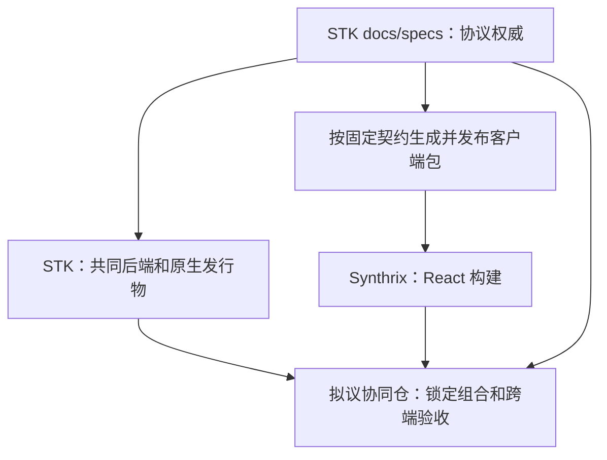

# 仓库协作与发布策略提案

更新：2026-11-06 UTC。状态：**proposal，尚未执行分仓、创建新仓或迁移代码**。本文供合作方周会、启动会和实施评审使用，不承诺尚未确认的人员投入、人数或截止日期。

本轮读取的 STK 文档提交为 `2319821ff6be3343a35813b3e5dcb201495c0dad`；三份设计的底层代码核验基线仍为 `535b0d63d15521ea7d4294ddfce2ac68a3555667`，不能将文档提交当成功能或发布验收。依据为[共享后端架构](../design/shared-backend-architecture.md)、[任务与数据协议](../design/distributed-task-data-protocol.md)、[场景验收](../design/distributed-workbench-acceptance.md)、[现有仓库结构](../repository-structure.md)和仓库 `AGENTS.md`。本轮沿用所有者批准的直接证据例外，暂缓完整 AOCI 加载与维护，不宣称索引已对齐。

开发阶段和会议表达分别见[平台开发路线](platform-roadmap.md)、[科研合作启动会](research-kickoff.md)。本文件规定仓库边界、依赖和交付协作，具体产品能力与验收门以三份设计及已发布 [specs](../specs/README.md)为准。

## 1. 建议决定：保留两个现有仓，按需要增加一个协同仓

STK 为合并主体。本地 Core、执行节点和云端使用同一后端代码、领域模型、状态机及应用服务；不同部署配置不产生不同业务实现。分仓围绕发布生命周期与维护边界，不按页面、编程语言或每个服务拆仓。

| 仓库 | 当前事实 | 建议目标与边界 |
|---|---|---|
| `stk`（现有） | 含 `suan/`、原生 `desktop/`、CLI、Runtime/Hub/节点、契约、测试、示例和部署配置 | 保留共同后端、C++/Python/GPU 原生能力、桌面与 CLI 的产品源码权威；Synthrix 领域逐项迁入共同应用服务。`docs/specs/` 保留协议权威 |
| `synthrix`（现有） | 当前有 React 网页和独立 Node/TypeScript 后端，尚非共同后端的纯客户端 | 保留 React 网页及网页测试/构建；旧 Node 领域逐项迁移、切换唯一写入归属并退出。过渡适配不成为永久第二后端 |
| `stk-platform`（**集成发布仓候选名，未创建**） | 本轮未开仓；启动时核对是否可复用已有同类仓及名称可用性 | 只保存跨仓版本组合清单、跨端验收编排、环境模板、部署和发布协调、回退说明及证据索引；不保存共同领域实现、另一套协议或私有研究原件 |

协同仓不承担业务调度权威，不建立产品数据库或新的任务状态机，也不是要求先建仓才能开发。其门槛未满足前，跨仓清单和编排可先随 STK 的 `deploy/`、测试及文档维护；若以后迁出，标明唯一入口与旧入口兼容/退役关系，不长期维护两份脚本。

当前 STK 的 `web/` 是 Hub 网页/PWA 和查看器，不因 Synthrix 被选作主要 React 入口就删除。按能力清单核对访问、查看和部署依赖，替代能力验收后再决定保留轻量入口或退出。`toolkits/ → suan/` 的既定内部整合继续遵守[现有迁移规则](../repository-structure.md#2026-09-28-讨论决定将-toolkits-整合进-suan)，不借分仓批量搬运仍被使用的代码。

## 2. STK 保留内部 monorepo 的理由

- C++ 原生编辑器、Python 桥、项目事务、文件/任务服务和 CLI 经常需要同一次契约修改与兼容验证；放在一仓可原子评审并复用回归夹具，避免把每次桌面改动变成多仓发布。
- 本地与云端必须执行同一规则。把“桌面后端”和“云后端”分别拆仓维护容易形成分叉；应在共同实现中使用部署角色和基础设施适配器。
- 原生运行库、Python 包、科学资源和许可证的实际打包关系尚需逐平台验证。先拆出 C++、GPU 或每个 Python 模块，并不会自动得到稳定 ABI 或独立产品。
- `archive/` 只保留历史来源，不进入构建、依赖或测试。既有 Qt、`toolkits/` 和可选插件按原退出门槛处理，不能因新仓规划提前删除。

因此第一步是清晰的包/模块边界与可独立验证的接口，不是重排整个代码树。外部 React 消费共同服务，并不要求先将 STK 再拆为多个仓。

## 3. 依赖 DAG 与契约唯一来源

下图是**构建、契约和发布依赖**，不表示运行时数据自动出站。

共同后端不依赖 Synthrix 源码或协同仓才能定义业务语义。协同仓消费两仓版本，不能反过来成为业务模块的源码依赖；测试编排可以检出两仓的固定提交，但不得导入另一仓未发布的内部源码作为产品运行依赖。

契约先只在 STK `docs/specs/` 及其明确引用的 schema 保持单一权威。设计文件仍是 proposal，不能经 SDK 生成提前变为已发布接口。Python/TypeScript/C++ 客户端按需要生成或封装并发布；包名和发布渠道实施前确定，不因此新建 SDK 仓。已有 SDK 或手写适配层要核对原版本规则，不能借生成器改变请求摘要、ID 或错误语义。

生成产物须绑定契约版本、契约源码提交/schema 摘要、生成器版本和产物摘要；消费者锁定发布包及其完整性信息。若需随源码存放生成文件，CI 从权威输入重生成并检查差异，禁止两仓各复制一份 schema 再手工维护。消费者不能从移动的 `main` URL 动态加载契约。

## 4. 一个发行组合锁定什么

建议为跨仓候选和发布建立不可变组合清单；以下是待实施字段要求，不是当前已存在的格式。

| 清单项 | 要求 |
|---|---|
| 组合身份与状态 | 独立组合 ID、清单 schema、候选/已验收状态、变更理由；失败与未知保留，不覆盖旧结果 |
| 源码输入 | STK、Synthrix、若已创建的协同仓各自完整 commit SHA；源码树/子模块及必要公开构建输入摘要 |
| 契约与客户端 | 各独立协议/schema 版本、SDK 精确版本和摘要、生成器版本；旧节点/客户端支持范围 |
| 构建制品 | wheel、原生安装包、Web 静态构建、镜像/离线包的精确版本和内容 digest；版本标签用于定位，digest 用于核对实际字节 |
| 数据与迁移 | 项目格式、各领域数据版本、迁移工具版本、备份/对账引用、切换及回退前提；不内嵌私有数据或凭据 |
| 验证证据 | 每项实际执行的源码/制品身份、平台、环境、用例版本、结果与必要跳过原因、资源闭环证据；与预期组合逐项比较 |
| 发布权限 | 批准角色及范围、目标环境、资源预算和配置引用；秘密值只在授权环境中解析 |

不能用“两个仓当前 main 都绿”代替组合验证。上游 CI 通过后若某仓又推进，原组合继续绑定原 SHA；新提交进入新候选。必要的多平台制品可以不同，但它们的共同后端源码修订与适配版本必须可核对。

## 5. 跨仓配套修改顺序

1. **先明确权威与兼容窗口**：在 STK 提案/规格中说明字段、权限、状态、数据与旧端行为；影响公开契约时按其版本规则扩展或升主版本。每个领域标明当前唯一写入方和切换条件。
2. **生产者先提供兼容能力**：STK 增量提供新应用服务/能力声明，保留支持窗口内旧入口；领域迁移先具备数据/回执对账和可验证回退路径。新增功能未协商时明确拒绝，不降级丢弃安全字段。
3. **发布客户端，再接消费者**：发布绑定新契约的 SDK/客户端包；Synthrix 使用精确版本开发，兼容当前已支持服务或清楚要求最低能力。不能先发布依赖未部署接口的网页。
4. **冻结跨仓候选**：锁定两个确切源码头及制品，执行契约、共同后端双部署和必要三端/真实节点验收；测试中用临时依赖覆盖时也须记录确切 SHA，发布前换成可获取的不可变制品。
5. **显式切换，逐领域退出旧 Node**：准备可校验备份、停写/在途操作核对、迁移对账和读取验证，再切换事实归属。不能同时向旧/新实现双发模型或科学执行；旧端点只做约定适配，旧写入不可继续接受。
6. **最后退役兼容层**：支持组合、进行中任务和旧回执恢复均已验收后，再按明确版本和公告退出。移除旧代码是有证据的独立交付，不因新代码合并而自动发生。

多仓不能原子提交，所以每一步必须独立可部署或明确保持候选状态。配套变更用同一个变更/组合引用互相链接，未合入或未发布的依赖列为 pending，不能把注释中的“随后会合入”当作准入条件已满足。

## 6. CI、交付证据与回滚

源仓各自负责单仓构建、单元/契约/安全和打包验证；协同编排负责组合与实际部署边界。共同后端同一修订需分别验证 local/cloud 配置，Web/CLI/Desktop 追踪同一任务事实；节点平台、许可软件、GPU 与 GUI 按[场景验收](../design/distributed-workbench-acceptance.md)逐项实测，stub 不替代真实执行。

CI 必须核对执行 workspace 的实际 HEAD、锁文件和制品摘要与组合清单一致。触发跨仓 workflow 时传固定 SHA/制品身份，不能只传分支名后在执行时取得另一版 `main`。若两次验证输入不同，分别保留真实 producer；只有明确审查的集合差异及适用范围证明才可复用未受影响结果，不能把旧报告重标为新源码。

当前 Linux 自托管 job 沿所有者指定标签 `[self-hosted, X64, Linux]` 使用；跨 OS job 按实际平台声明。标签仅用于选择 runner，不证明节点能力、隔离或平台验收通过。测试使用本轮自有资源并正常清理，不占用/清理他人服务；缺少许可、字体、硬件等依赖时记录未验收或阻塞，不能靠跳过必需检查制造通过。

回滚单位是**已验收组合和可兼容的数据状态**，不是随手将两个仓各退一个 commit：

- 网页回退先确认旧网页/SDK能读取当前服务及数据；服务回退确认旧实现支持已写入格式和回执，否则停止切换并保留兼容读取/恢复路径。
- 领域切换有新写入后，不能还原旧库抹掉新事实。先停相关写入，核对增量，执行已验证的恢复/迁移步骤；禁止自动重放外部副作用。
- 运行中任务保持原 authority、Task/Attempt、执行器与已接受请求身份；部署回退不取消、迁移或重新启动它们。旧程序继续运行所需依赖按原冻结/兼容规则保留。
- 已发布候选和证据不可变；回退产生新记录并引用原组合，不覆盖原失败或撤回事实。回退权限和上线权限分别明确，不能默认为所有开发者拥有。

STK 继续遵守现行 main 开发规则：常规交付不默认建分支/PR，不自动整合无关 PR；代码推送前等前一代码头 desktop CI 结束、记录实际结果，提交前按 `.gitleaks.toml` 扫描暂存改动。新仓如获准建立，应显式制定其 AGENTS、评审和发布权限，不能假设自动继承管理权限。本轮仅交付设计，不创建仓库、迁移业务代码或修改 workflow。

## 7. 角色 RACI（待分配，不代表新增人数）

角色可由同一人兼任，但实际人员与替补需在启动会上确认；既有独立复核/权限分离要求仍有效，兼任不能绕过。
P＝产品与科研负责人；B＝共同后端/原生维护；W＝网页维护；D＝集成与发行维护；S＝数据与许可授权负责人。
R 负责执行，A 对结果/决定最终负责，C 必须协商，I 知会；每行一个 A。

| 工作 | P | B | W | D | S |
|---|---|---|---|---|---|
| 范围、阶段验收与新仓批准 | A | C | C | R | C |
| STK 契约、共同领域和兼容性 | C | A/R | C | C | C |
| React 入口、网页 SDK 接入与草稿保护 | C | C | A/R | C | C |
| 组合清单、跨仓门禁、制品与回退准备 | I | C | C | A/R | C |
| 私有资料访问、节点/数据出口及软件许可授权 | C | R | C | C | A |
| 领域迁移及数据/原操作回执对账 | C | A/R | R | R | C |

合作方会议使用公开可共享的进度、合成算例和明确授权证据；合作关系不自动赋予仓库写权、生产访问或私有项目访问。公开文件统一称“合作方”，不写真实组名、账号或秘密。

## 8. 开仓阈值与迁移顺序

| 对象 | 何时才值得独立仓 | 此前如何处理 |
|---|---|---|
| integration/delivery 协同仓（proposal） | 已有至少一个需要反复验收/发行的跨仓组合；确定维护与发布角色、资源归属及凭据边界；单仓测试与跨仓测试职责可分清 | 清单/编排先留 STK，不新增空壳仓或第三套业务源码 |
| 独立插件仓（proposal，逐个决定） | 插件具有稳定版本化入口、可独立发布/退役的生命周期，以及明确维护或许可边界；安装/授权/回退可验收 | 内置能力留 `suan/`/原生模块，现有可选 `plugins/` 按原边界维护；不声称通用插件 ABI 已完成 |
| 私有研究资料仓/存储（proposal） | 确需与公开代码分离的访问、保留和授权周期，且资料管理方式适合其体量及审计要求 | 不把私有资料加入公开仓；大文件用获准资源存储及不可变引用，Git 仓不替代 Artifact/Replica/Transfer |
| 独立 contracts、SDK、后端语言或微服务仓 | 当前无开仓必要；只有产生可证明的独立维护/发布需求且不会造成权威分叉后再评审 | 契约留 STK，SDK 发布包供消费，后端和原生组件在 STK 内模块化 |

建议次序与架构 D0–D5 对齐：先固定职责/契约及共同后端装配，再完成一条锁定版本的跨端任务链；随后按领域迁移 Synthrix，达到门槛时才建立协同仓并转移编排；插件/资料权限仓最后按实际需求逐项申请。无需等所有仓建立才开始共同后端工作，也不为会议展示提前创建仓库、团队或访问授权。

本提案没有确认开发人数、日期或私有资料保存位置；`stk-platform` 仅为候选名称，未作远端创建或可用性承诺。启动会应明确阶段负责角色、首条可验收链和依赖/资源，再形成实际排期；周会按已完成证据、下一验收门和外部阻塞汇报，不能将设计完成计作功能完成。
